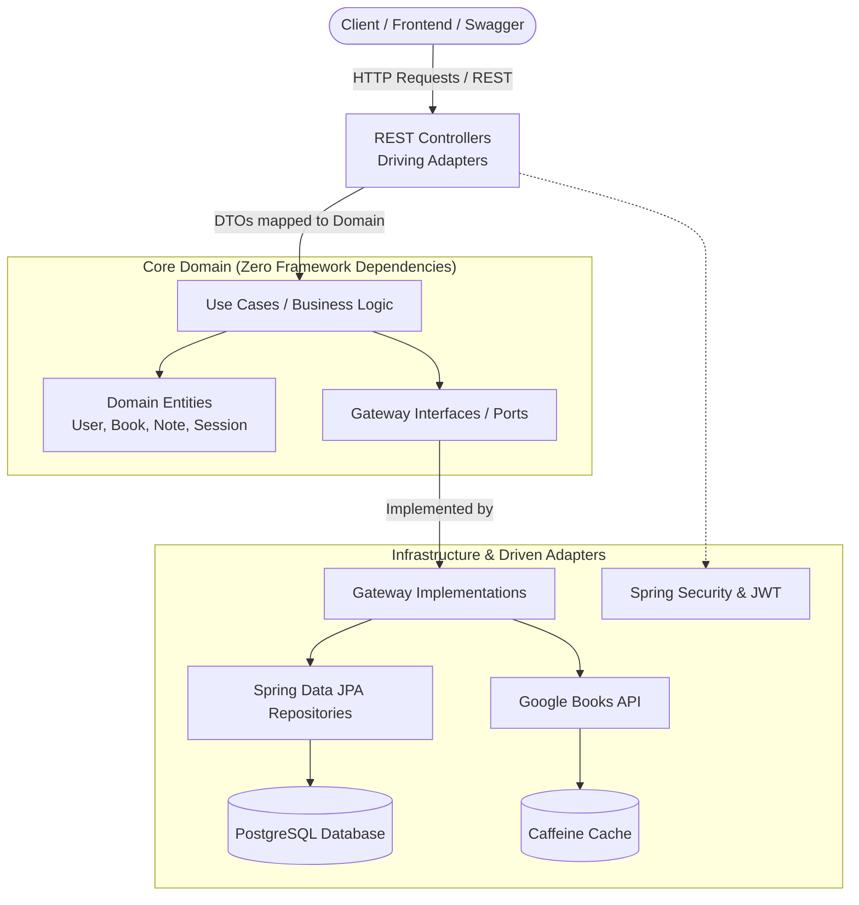

# <p align="center">InkTrack API</p>

<p align="center">
  <em>A modern, robust, and scalable RESTful API for book reading management, tracking reading sessions, notes, and analytics built with Clean & Hexagonal Architecture.</em>
</p>

<p align="center">
  <!-- Badges: customize according to your project (shields.io) -->
  <a href="https://github.com/felipemelozx/InkTrack-api/stargazers"></a>
  <a href="https://github.com/felipemelozx/InkTrack-api/network/members"></a>
  <a href="https://github.com/felipemelozx/InkTrack-api/issues"></a>
  <a href="https://github.com/felipemelozx/InkTrack-api/blob/main/LICENSE"></a>
</p>

<p align="center">
  <!-- Quick navigation / Demo links -->
  <a href="#-about">About</a> •
  <a href="#-features">Features</a> •
  <a href="#-tech-stack">Tech Stack</a> •
  <a href="#-architecture">Architecture</a> •
  <a href="#-getting-started">Getting Started</a> •
  <a href="https://inktrack.netlify.app" target="_blank">Live Demo 🚀</a>
</p>

---

<!-- Project banner image -->
<p align="center">
  
</p>

---

## 📑 Table of Contents

1. [About](#-about)
2. [Features](#-features)
3. [Tech Stack](#-tech-stack)
4. [Architecture](#-architecture)
5. [Project Structure](#-project-structure)
6. [Getting Started](#-getting-started)
   - [Prerequisites](#prerequisites)
   - [Installation](#installation)
   - [Running](#running)
   - [Tests](#tests)
7. [Configuration](#-configuration)
8. [Security](#-security)
9. [How to Contribute?](#-how-to-contribute)
10. [What's Next? (Roadmap)](#-whats-next-roadmap)
11. [License](#-license)
12. [Acknowledgements](#-acknowledgements)
13. [Author & Contact](#-author--contact)

---

## 💡 About

> [!NOTE]  
> **InkTrack API** was built to centralize, organize, and elevate the reading tracking experience. It solves the fragmentation of keeping notes across physical notebooks or loose spreadsheets, delivering a dependable, high-performance backend solution.

**InkTrack API** serves as the backbone for an ecosystem crafted for avid readers, students, and lifelong learners who want quantitative and qualitative insights into their reading habits. Developed with **Java 17** and **Spring Boot 4**, it strictly follows **Hexagonal Architecture (Ports and Adapters)** principles to keep domain business rules isolated from frameworks, databases, and third-party dependencies.

### 🎯 Key Objectives
- **Efficiency**: Automate progress calculation, reading velocity, and completion forecasts without manual effort.
- **User Experience & Integrations**: Seamless metadata enrichment and book cover discovery via **Google Books API** with resilient in-memory caching.
- **Scalability & Reliability**: Fully decoupled architecture backed by >80% automated test coverage, strict quality gates, and automated CI/CD pipelines.

---

## ✨ Features

- [x] 🔒 **Secure Authentication & Dual Tokens**: Registration and login using Access Tokens (15 min) and Refresh Tokens (7 days), protected with BCrypt password hashing.
- [x] 📚 **Personal Library Management (CRUD)**: Complete management of books partitioned strictly per authenticated user, with categories and pagination.
- [x] 🔍 **Google Books API Integration**: Search books by title, author, or ISBN, fetch metadata and high-res covers with in-memory caching (Caffeine).
- [x] ⏱️ **Reading Session Logging**: Track minutes spent and pages read per session, instantly updating overall book completion percentages.
- [x] 📊 **Advanced Metrics & Analytics**:
  - General metrics: total books, average completion rate, remaining pages, and estimated finish dates.
  - Session velocity and reading pace analytics.
  - Shelf distribution by category.
  - Reading evolution timeline with customizable windows (`30d`, `3m`, `6m`, `12m`).
- [x] 📝 **Notes System**: Create, update, and manage book-specific notes with full audit timestamps (`createdAt` and `updatedAt`).
- [x] ⚡ **High Performance & Resilience**: Optimized PostgreSQL queries preventing N+1 issues, sub-100ms average response times, and Flyway schema versioning.

---

## 🛠️ Tech Stack

### Backend & Core


### Database, Cache & Migrations


### Security & Authentication


### Tools, Testing & DevOps


---

## 🏛️ Architecture

**InkTrack API** strictly adheres to **Hexagonal Architecture (Ports & Adapters)** and **Clean Architecture** principles:



- **Core Domain (`com.inktrack.core`)**: Isolated layer with zero framework dependencies (no Spring, no JPA imports). Contains pure domain models, business exceptions, use cases, and gateway port contracts.
- **Infrastructure (`com.inktrack.infrastructure`)**: Implements secondary ports defined by the core (database persistence, HTTP integrations, JWT security, mappers, and REST controllers).
- **Google Books Integration**: Uses Spring's `RestClient` with timeout resilience and an in-memory `Caffeine` cache (5-minute TTL) to minimize redundant network calls.

---

## 📂 Project Structure

```bash
├── 📁 .github/                  # CI/CD Workflows (Tests, SonarCloud, Deployment, CodeQL)
├── 📁 doc/                      # Technical documentation and visual assets
│   ├── 📄 banner.jpg            # Official project banner
│   └── 📄 psd.md               # Product Specification Document
├── 📁 src/
│   ├── 📁 main/
│   │   ├── 📁 java/com/inktrack/
│   │   │   ├── 📁 core/                 # Pure domain layer (framework-agnostic business logic)
│   │   │   │   ├── 📁 domain/           # Core entities (User, Book, Category, Note, etc.)
│   │   │   │   ├── 📁 exception/        # Domain-specific exceptions
│   │   │   │   ├── 📁 gateway/          # Port contracts / interfaces (UserGateway, BookGateway, etc.)
│   │   │   │   ├── 📁 usecases/         # Business logic use cases organized by feature
│   │   │   │   └── 📁 utils/            # Business validation utilities (e.g., PasswordCheck)
│   │   │   ├── 📁 infrastructure/       # Technology layer and adapters
│   │   │   │   ├── 📁 beans/            # Spring configuration beans and dependency injection
│   │   │   │   ├── 📁 config/           # Technical configs (Cache, Google Books, CORS)
│   │   │   │   ├── 📁 controller/       # Primary adapters (REST API controllers)
│   │   │   │   ├── 📁 dtos/             # API request and response DTOs
│   │   │   │   ├── 📁 entity/           # JPA entities mapped to PostgreSQL
│   │   │   │   ├── 📁 gateway/          # Secondary adapters (gateway implementations)
│   │   │   │   ├── 📁 mapper/           # Manual DTO <-> Domain object mappers
│   │   │   │   ├── 📁 persistence/      # Spring Data JPA repositories
│   │   │   │   └── 📁 security/         # JWT filters, CORS policy, and security configs
│   │   │   └── 📄 InkTrackApplication.java
│   │   └── 📁 resources/
│   │       ├── 📁 db/migration/         # Versioned database migrations (Flyway)
│   │       └── 📄 application.properties# Spring Boot configuration
│   └── 📁 test/                         # Unit and integration test suite
├── 📄 .env.example              # Environment variables template
├── 📄 custom_check.xml          # Checkstyle rules and code quality thresholds
├── 📄 docker-compose.prod.yaml  # Production Docker Compose orchestration with Traefik
├── 📄 docker-compose.yaml       # Local development PostgreSQL setup
├── 📄 Dockerfile                # Multi-stage optimized Docker build
├── 📄 pom.xml                   # Maven dependencies and build plugins
└── 📄 README.md                 # Main repository documentation
```

---

## 🚀 Getting Started

Follow the steps below to configure and run the API in your local environment.

### Prerequisites
- **Java JDK** 17 or higher installed
- **Maven** 3.8+ (or use the included `./mvnw` wrapper)
- **Docker** & **Docker Compose** *(recommended for running PostgreSQL)*
- **Git** to clone the repository

### Installation

1. Clone the repository:
```bash
git clone https://github.com/felipemelozx/InkTrack-api.git
cd InkTrack-api
```

2. Set up the environment variables file:
```bash
cp .env.example .env
```

3. Start the PostgreSQL database via Docker Compose:
```bash
docker-compose up -d postgres
```

### Running

#### Option 1: Run with Maven Wrapper (Local Development)
```bash
./mvnw spring-boot:run
```
The API will be available at `http://localhost:8080/api/v1` (or your configured port in `.env`).

#### Option 2: Run with Docker Compose (Production Setup)
```bash
docker-compose -f docker-compose.prod.yaml --env-file .env up -d --build
```

#### Health Check Verification
Once started, verify the service status:
```bash
curl http://localhost:8081/api/v1/actuator/health
```

### Tests

Run the test suite using Maven:

```bash
# Run all unit and integration tests
./mvnw test

# Run tests and generate JaCoCo code coverage report
./mvnw clean verify

# Verify code style and architectural boundaries with Checkstyle
./mvnw checkstyle:check
```

---

## ⚙️ Configuration

Environment variables must be configured in your `.env` file:

| Variable | Type | Required | Description | Default / Example |
| :--- | :---: | :---: | :--- | :--- |
| `API_SECRET_KEY` | `string` | Yes | Private signing key for JWT tokens (`openssl rand -base64 64`) | `super-secure-secret-key-here` |
| `POSTGRES_USER` | `string` | Yes | PostgreSQL username | `inktrack_user` |
| `POSTGRES_PASSWORD` | `string` | Yes | PostgreSQL password | `inktrack_password` |
| `POSTGRES_DB` | `string` | Yes | PostgreSQL database name | `inktrack_db` |
| `FRONT_URL` | `string` | Yes | Allowed frontend origin for CORS | `http://localhost:3000` |
| `APP_PORT` | `number` | No | Port exposed by application/container | `8081` |
| `SERVER_CONTEXT_PATH` | `string` | No | Global REST endpoint prefix | `/api/v1` |
| `SPRING_PROFILES_ACTIVE` | `string` | No | Active Spring profile (`dev`, `prod`) | `prod` |
| `GOOGLE_BOOKS_API_KEY` | `string` | No | Google Books API key for higher rate limits | `AIzaSy...` *(optional)* |
| `GOOGLE_BOOKS_MAX_RESULTS` | `number` | No | Maximum book search results returned | `10` |
| `GOOGLE_BOOKS_TIMEOUT_MS` | `number` | No | External API request timeout (ms) | `5000` |
| `GOOGLE_BOOKS_CACHE_MAX_SIZE` | `number` | No | Maximum search query cache capacity | `100` |
| `GOOGLE_BOOKS_CACHE_EXPIRATION_MINUTES` | `number` | No | Caffeine cache time-to-live (minutes) | `5` |
| `API_DOMAIN` | `string` | No | Traefik reverse proxy domain for production | `api.yourdomain.com` |

---

## 🛡️ Security

Data security and integrity are central tenets of **InkTrack API**:

- **Strong Password Hashing**: Passwords hashed with `BCrypt` and salted automatically.
- **Domain Password Complexity**: Validated via domain utilities requiring at least 8 characters, uppercase, lowercase, numbers, and special characters.
- **Stateless JWT Dual-Token Flow**:
  - **Access Token**: Short-lived (15 minutes), mitigating replay attack risks.
  - **Refresh Token**: Long-lived (7 days), stored securely with database validation and revocation capability.
- **Custom JWT Filter (`JwtSecurityFilter`)**: Intercepts protected routes and validates token signatures before delegating to Spring Security context.
- **Tenant Isolation**: Service-level enforcement ensuring users can only read, write, update, or delete their own books, notes, and analytics.
- **Strict CORS Policy**: Restricted cross-origin resource sharing configured per environment.
- **Injection Protection**: Parameterized queries via Spring Data JPA to eliminate SQL Injection, combined with Bean Validation on incoming DTO payloads.

### Reporting Vulnerabilities
If you discover any security vulnerabilities, please **DO NOT** open a public issue. Send an email to `felipemelozx@gmail.com` or submit a private report via GitHub Security Advisories.

---

## 🤝 How to Contribute?

Contributions are warmly welcome! To contribute to the project:

1. **Fork** the repository
2. **Create a branch** for your feature or bug fix:
   ```bash
   git checkout -b feature/my-new-feature
   ```
3. **Validate code style and run tests**:
   ```bash
   ./mvnw checkstyle:check
   ./mvnw test
   ```
4. **Commit your changes** following [Conventional Commits](https://www.conventionalcommits.org/):
   ```bash
   git commit -m "feat: add monthly reading goals endpoint"
   ```
5. **Push to your remote branch**:
   ```bash
   git push origin feature/my-new-feature
   ```
6. **Open a Pull Request** describing your changes and tests performed.

---

## 🗺️ What's Next? (Roadmap)

Planned milestones and future enhancements for InkTrack:

- [x] Robust JWT authentication and authorization (Access & Refresh tokens).
- [x] Full CRUD operations for books, categories, and linked notes.
- [x] Google Books API integration with resilient in-memory caching (Caffeine).
- [x] Advanced reading analytics (30d/3m/6m/12m evolution, category distribution, finish estimates).
- [x] Automated test suite with >80% coverage and SonarCloud Grade A.
- [ ] Personalized reading goals (monthly and annual targets by pages or book counts).
- [ ] AI-powered note summaries and reading habit insights.
- [ ] Multi-language support (i18n - English, Portuguese, Spanish).
- [ ] Automated reading reminders via email and web push notifications.
- [ ] Companion cross-platform mobile application.

---

## 📄 License

This project is licensed under the **MIT License**. See the [LICENSE](LICENSE) file for more details.

```text
MIT License - Copyright (c) 2026 Felipe Melo
```

---

## 🙏 Acknowledgements

- [Spring Boot](https://spring.io/projects/spring-boot) - For an enterprise-grade, productive backend ecosystem.
- [Google Books API](https://developers.google.com/books) - For comprehensive global book data and metadata.
- [Flyway](https://flywaydb.org/) - For reliable, versioned database migrations.
- [SonarCloud](https://sonarcloud.io/) - For continuous code quality and maintainability gates.
- [Shields.io](https://shields.io/) - For crisp, informative repository badges.

---

## 👤 Author & Contact

Developed with care by **Felipe Melo (@felipemelozx)** 🚀

<p align="left">
  <a href="https://linkedin.com/in/felipemelozx" target="_blank">
    
  </a>
  <a href="https://github.com/felipemelozx" target="_blank">
    
  </a>
  <a href="https://felipemelozx.com/" target="_blank">
    
  </a>
  <a href="https://inktrack.netlify.app" target="_blank">
    
  </a>
</p>
